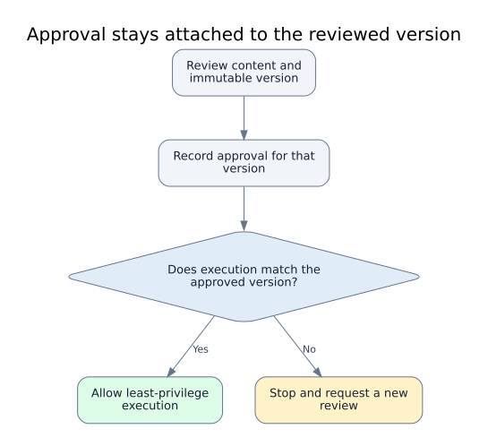
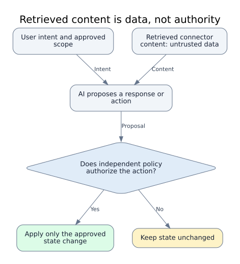
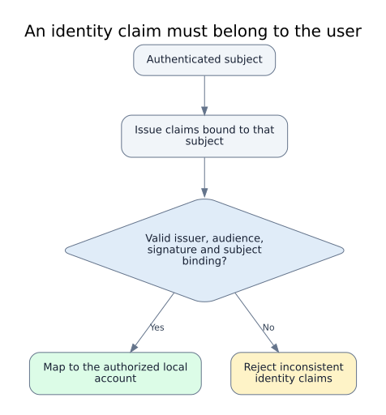
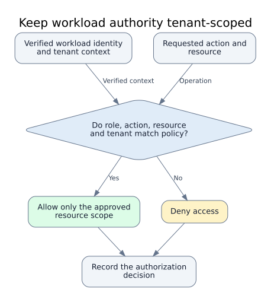
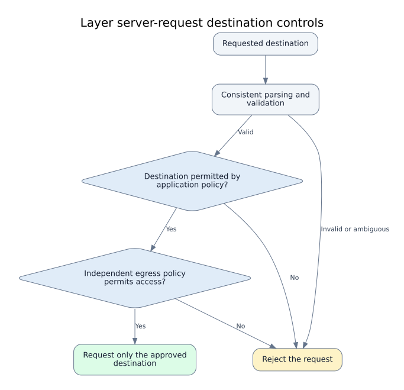
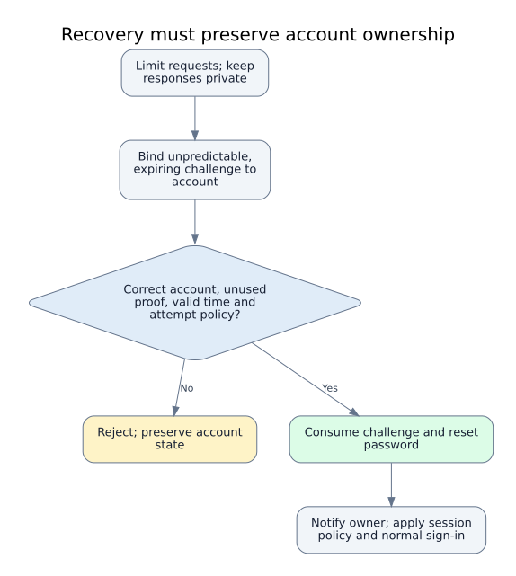
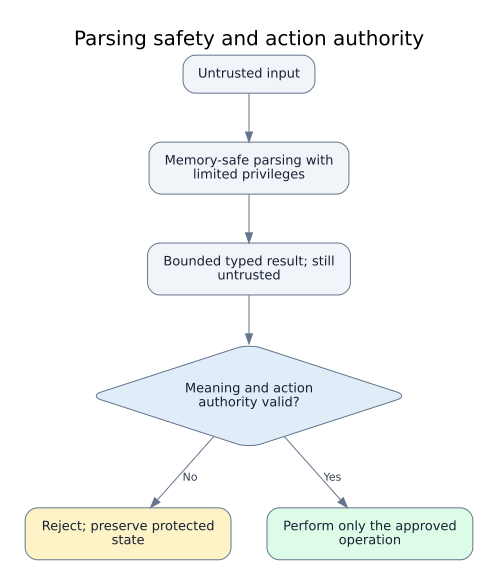
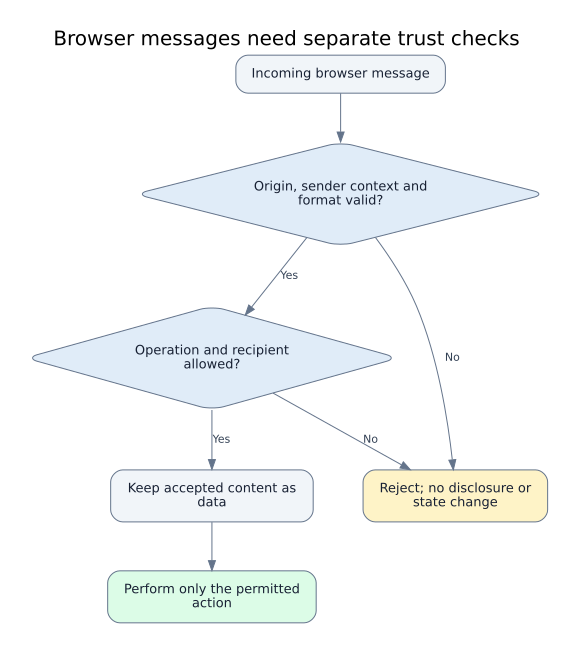

# Visual theory: defensive trust boundaries

These are original conceptual models grounded in linked disclosures and official guidance. They explain security decisions, not the exact architecture of a vendor or an exploitation sequence. Each record links its evidence and supplies accessible alternate text.

## Bind approval to an immutable version



The system should execute exactly the content that was approved. Check the version when granting approval and again when the privileged component uses it.

[Evidence and metadata](../data/diagrams/approval-version-integrity.json) · [Mermaid source](../diagrams/approval-version-integrity.mmd)

## Separate AI content from action authority



Retrieved content can inform a response without gaining authority to change persistent state. The model's proposed action is a request to validate, not permission by itself.

[Evidence and metadata](../data/diagrams/ai-content-authority-separation.json) · [Mermaid source](../diagrams/ai-content-authority-separation.mmd)

## Preserve identity ownership across integrations



A valid signature is one check among several. The issued claims must still refer to the authenticated subject and the intended relying application.

[Evidence and metadata](../data/diagrams/identity-claim-binding.json) · [Mermaid source](../diagrams/identity-claim-binding.mmd)

## Keep workload authority tenant-scoped



Authenticating a workload does not determine everything it may access. Bind authorization to the requested operation and tenant, keep credentials short-lived where supported, and review unused permissions separately. This connects the Meta and Actifio cases with AWS IAM guidance.

[Evidence and metadata](../data/diagrams/workload-identity-tenant-scope.json) · [Mermaid source](../diagrams/workload-identity-tenant-scope.mmd)

## Layer server-request destination controls



Combine application policy with an independent network boundary. Choose destination restrictions that fit the service’s documented purpose.

[Evidence and metadata](../data/diagrams/server-request-destination-policy.json) · [Mermaid source](../diagrams/server-request-destination-policy.mmd)

## Preserve ownership through account recovery



Check which account each challenge belongs to, how attempts are counted and what happens to sessions after a reset. Review these rules together. This conceptual model connects the GitLab, Microsoft and Instagram cases.

[Evidence and metadata](../data/diagrams/account-recovery-challenge-lifecycle.json) · [Mermaid source](../diagrams/account-recovery-challenge-lifecycle.mmd)

## Separate parsing safety from action authority



Memory safety and restricted privileges reduce parsing risk. Successfully parsing a request still does not give permission to carry it out. Keep that access decision independent of the parser.

[Evidence and metadata](../data/diagrams/parsing-safety-action-authority.json) · [Mermaid source](../diagrams/parsing-safety-action-authority.mmd)

## Keep browser message identity separate from authority



Knowing where a message came from does not settle what it may request or which data its recipient may receive. Keep those decisions explicit and prevent accepted content from becoming executable markup. This is a conceptual design model, not a description of Meta’s exact patch.

[Evidence and metadata](../data/diagrams/browser-message-authority-boundaries.json) · [Mermaid source](../diagrams/browser-message-authority-boundaries.mmd)

## Respect the server-to-client disclosure boundary


Data is not safe to send to a browser just because it came from a server. Select only the fields the recipient may receive, then handle the content safely for the context where it will be used.

[Evidence and metadata](../data/diagrams/server-client-data-consumer-boundaries.json) · [Mermaid source](../diagrams/server-client-data-consumer-boundaries.mmd)

## Check build evidence at the artifact consumer


Keep untrusted contributions separate from trusted build state. Then, before using a build artifact, check that its authenticated provenance matches the artifact and the expected build. Passing that check still leaves the rest of the release review to do; provenance does not guarantee vulnerability-free software.

[Evidence and metadata](../data/diagrams/build-artifact-provenance-boundary.json) · [Mermaid source](../diagrams/build-artifact-provenance-boundary.mmd)

## Separate public errors from internal diagnostics


Decide what an error response may reveal and what belongs only in diagnostics. Give clients a minimal response. Collect only useful diagnostic details and protect them separately. Internal logs still need a legitimate purpose, restricted access and a retention policy.

[Evidence and metadata](../data/diagrams/error-diagnostic-disclosure-boundary.json) · [Mermaid source](../diagrams/error-diagnostic-disclosure-boundary.mmd)

## Preserve every source’s access boundary in a combined view


Permission to read one source does not grant access to another. In this all-or-nothing model, both sources must permit the caller, and the combined response must retain each source's field restrictions. It connects GitHub's cross-repository comparison disclosure with Frappe's linked-document response disclosure and OWASP authorization guidance. Returning partial results needs a separate policy for omitting inaccessible data without revealing it. The model does not cover snapshot consistency, races with permission changes or information inferred from combined values.

[Evidence and metadata](../data/diagrams/combined-view-source-authorization.json) · [Mermaid source](../diagrams/combined-view-source-authorization.mmd) · [DOT source](../diagrams/combined-view-source-authorization.dot)

## Preserve the original caller's authority through fallbacks


A fallback must stay within the original caller's permissions. An access denial ends this operation. A recoverable operational failure may justify considering a fallback, but application policy must still permit it for the original caller, regardless of which identity executes it. This editorial model connects the researcher's account of Instagram's privileged error handling with OWASP authorization guidance. It does not describe Instagram's architecture or patch. It also does not cover separately authorized background work, permission freshness, revocation or distributed consistency.

[Evidence and metadata](../data/diagrams/fallback-requester-authorization.json) · [Mermaid source](../diagrams/fallback-requester-authorization.mmd) · [DOT source](../diagrams/fallback-requester-authorization.dot)

## Keep delegated authority within the approved grant


A grant authorizes a particular subject, client and set of permissions. Keep those limits through first issuance and renewal, even if the protocol steps differ. The user's wider access and the client's registration do not expand the grant. Issuing less authority, or adding authority with separate approval, still fits this model.

This editorial model connects the Google device-grant disclosure, n8n's refresh-resource advisory and RFC 9700 sections 2.3 and 4.14.2. It assumes that grant context is protected against tampering and that applicable client checks have been performed. It does not prescribe storage, describe vendor architecture or verify a deployed fix. Revocation, concurrency, replay protection and consent usability are outside its scope.

[Evidence and metadata](../data/diagrams/delegated-grant-authority-continuity.json) · [Mermaid source](../diagrams/delegated-grant-authority-continuity.mmd) · [DOT source](../diagrams/delegated-grant-authority-continuity.dot)

## Rendering and maintenance

The Mermaid and Graphviz sources are generated from the same canonical node/edge graph. The SVG companions were rendered offline with Graphviz and visually inspected. A Mermaid engine was not executed. To regenerate with an installed Graphviz version:

```sh
python3 scripts/render_diagrams.py
python3 scripts/render_diagrams.py --check
python3 scripts/validate_extra.py
```

After changing a graph, inspect the rendered SVG before marking visual QA passed. Resource and diagram metadata are included in the separate resources export.
